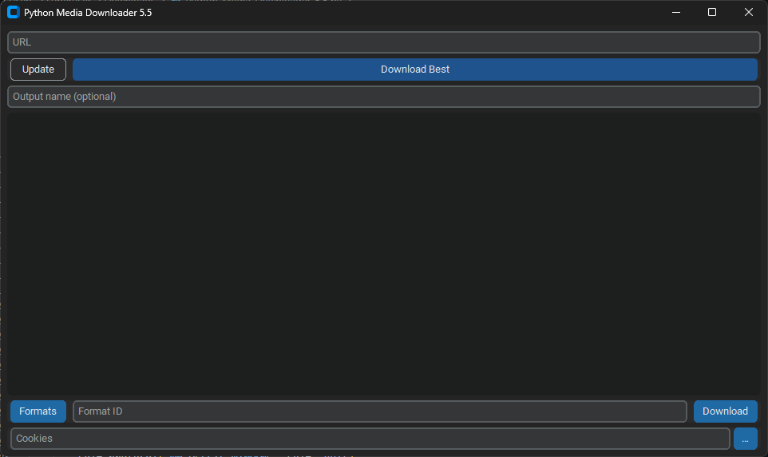

# Python Media Downloader



A lightweight, asynchronous, cross-platform graphical user interface (GUI) front-end for [`yt-dlp`](https://github.com/yt-dlp/yt-dlp), built with Python and [`CustomTkinter`](https://github.com/TomSchimansky/CustomTkinter).

The application provides a modern desktop interface for querying available media streams, downloading single videos and full playlists, injecting authentication cookies, and muxing high-resolution video and audio feeds into Matroska (`.mkv`) containers.

## Features

- **Automated Stream Selection:** Download the optimal video and audio stream combination (`bestvideo+bestaudio/best`) muxed automatically into an MKV container.
- **Smart Playlist Detection:** Automatically distinguishes between standalone items and playlists, organizing multi-item downloads into dedicated, sanitized subdirectories with index prefixing.
- **Granular Format Selection:** Inspect all remote stream formats (`-F`) directly in the application log and select explicit Format IDs for targeted extraction.
- **Authentication & Cookie Injection:** Supports Netscape/JSON format cookie files via a native file picker or browser-level cookie extraction (e.g., `chrome`, `firefox`, `edge`).
- **Real-Time Terminal Emulation:** Thread-safe, non-blocking standard output (stdout/stderr) streaming with automatic line truncation to prevent memory exhaustion during long operations.
- **Robust Process Isolation:** Safe process termination and cancellation handlers using platform-specific process groups (`taskkill` on Windows, `killpg` on POSIX systems).
- **In-App Dependency Updates:** Update the bundled or system `yt-dlp` executable directly from the GUI.

## Prerequisites

```powershell
winget install DenoLand.Deno Gyan.FFmpeg Python.Python.3.12
pip install customtkinter
pip install -U "yt-dlp[default]"
```

## Usage

| Element | Description |
| :--- | :--- |
| **URL Field** | The target media or playlist URL. |
| **Update** | Executes `yt-dlp -U` (or upgrades via `pip`) to ensure extractor extractors are up to date. |
| **Download Best** | Evaluates the URL. If a playlist is detected, it downloads the playlist into a dedicated folder. If a single item is detected, it downloads the best combined streams to the `Downloads/` directory. |
| **Output name (optional)** | Specify a custom filename. Special characters are automatically sanitized. For playlists, this overrides the subfolder name. |
| **Formats** | Queries the URL and outputs all available stream IDs, resolutions, codecs, and bitrates to the log console. |
| **Format ID Field** | Input the specific format code(s) (e.g., `137+140` or `22`) desired for manual download. |
| **Download** | Downloads the specified **Format ID** for the current URL. |
| **Cookies** | Path to a Netscape cookie `.txt` file, or the plain-text name of a supported browser (e.g., `chrome`, `firefox`, `brave`, `edge`). Click `…` to open a file browser. |

## Sources
- **Claude Sonnet 4.5**: Eliminated four critical threading, playlist detection, and log-handling bugs. Ensured TOCTOU safety and robust playlist handling for edge cases (2.5).
- **Gemini 3.1 Pro Preview**: Engineered the final, bulletproof multi-threaded architecture, queue logging, and graceful OS-level process handling (2.0).
- **Gemini 3 Pro Preview**: Introduced advanced FFmpeg encoding pipelines, system reconnaissance, and advanced command list structuring (1.0).
- **Gemini 2.5 Pro**: Provided the first major code cleanup, stripping redundant libraries and establishing solid Python logic (0.8).
- **ChatGPT-3.5 & ChatGPT-4o**: Assisted with foundational logic, UI sizing, and early debugging (0.4 - 0.6).
- https://www.youtube.com/watch?v=NI9LXzo0UY0
- https://www.youtube.com/watch?v=Miydkti_QVE
- https://www.youtube.com/watch?v=Envp9yHb2Ho
- https://www.youtube.com/watch?v=EwL2BwEdduE
- https://www.youtube.com/watch?v=a0MVOloNLB4
- https://www.youtube.com/watch?v=GeflXCubyrA
- https://www.youtube.com/watch?v=QRroCuY1Bhc
- https://www.youtube.com/watch?v=df30Qro3Iu4
- (Note: Some original tutorial videos have since been deleted or made private.)
- https://github.com/yt-dlp/yt-dlp
- https://github.com/TomSchimansky/CustomTkinter
- https://www.google.com

## Disclaimer

This software is an open-source graphical frontend designed for legitimate media management and backup purposes. Users are responsible for complying with the terms of service of any host platform and all applicable local, national, and international copyright laws. The developers assume no liability for misuse of this software.
